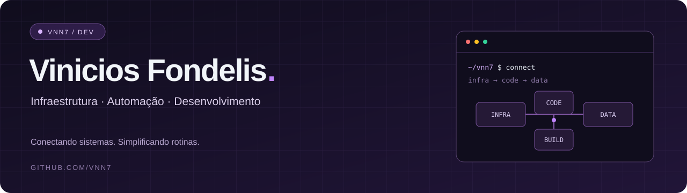

<p align="center">
  
</p>

<p align="center">
  
</p>

<p align="center">
  <a href="https://github.com/Vnn7?tab=repositories"></a>
  
</p>

### Olá, eu sou o Vinicios.

Gosto de conectar infraestrutura, código e dados para transformar problemas do dia a dia em soluções práticas. Por aqui, compartilho projetos de automação, ambientes com containers e aplicações que fazem essas peças trabalharem juntas.

```text
$ whoami
Vinicios Fondelis · @Vnn7

$ foco
Infraestrutura / Automação / Desenvolvimento

$ por_aqui
Containers, integração de dados e aplicações web e mobile.
```

### Tecnologias nos meus projetos

<p>
  
  
  
  
  
  
</p>

<p align="center">
  <a href="https://github.com/Vnn7?tab=repositories">Explore meus repositórios →</a>
</p>

---

<p align="center"><sub>Infraestrutura como base. Automação como ferramenta. Código para conectar tudo.</sub></p>
